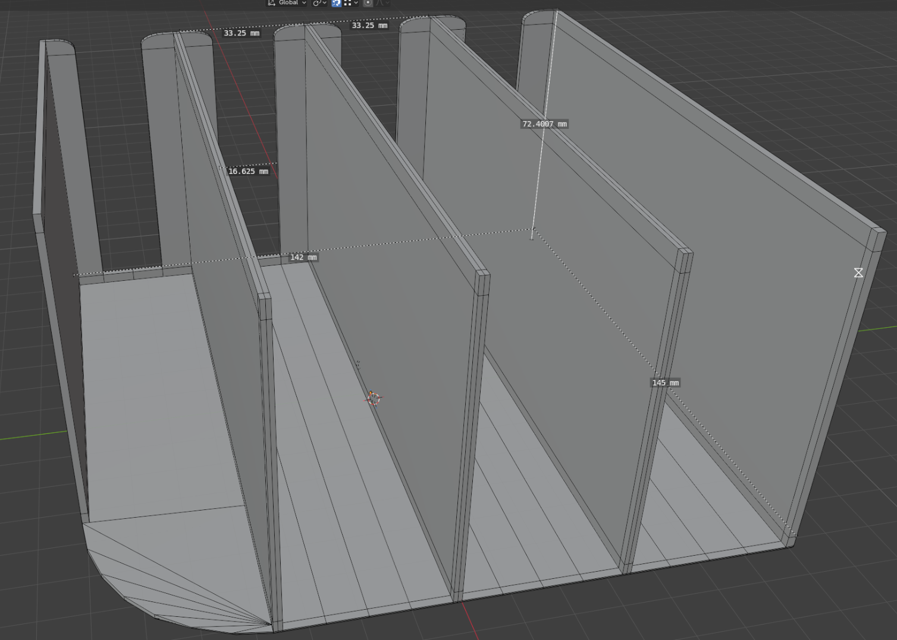
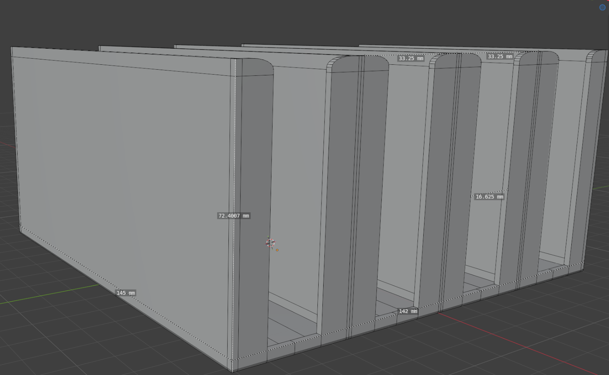
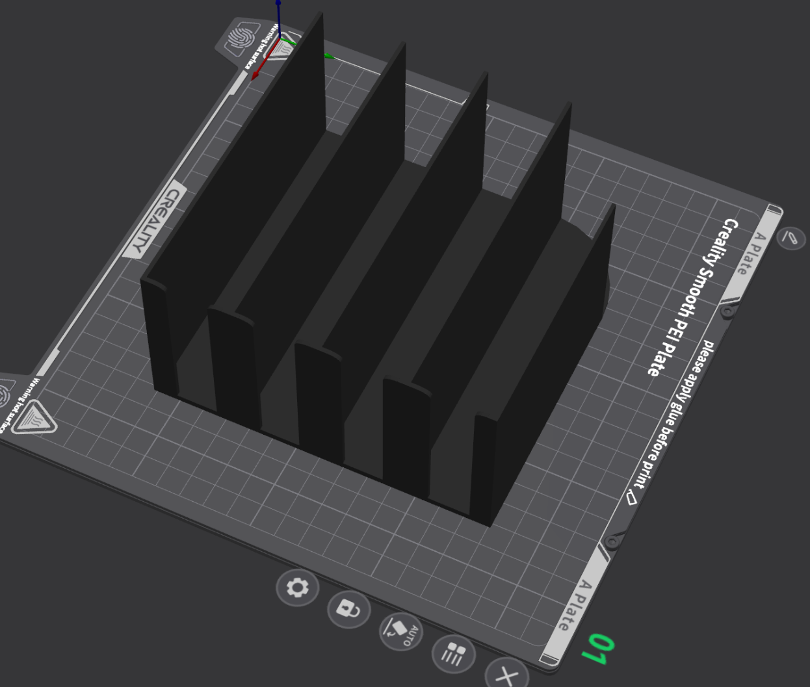
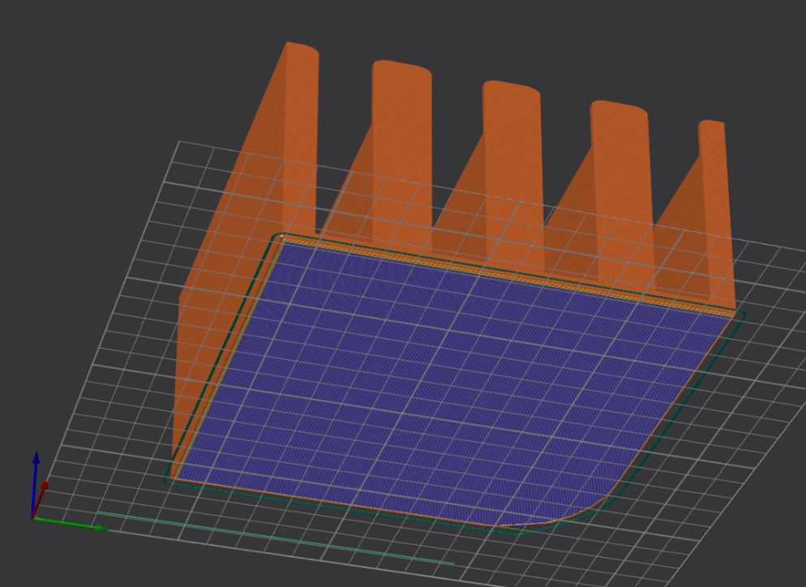
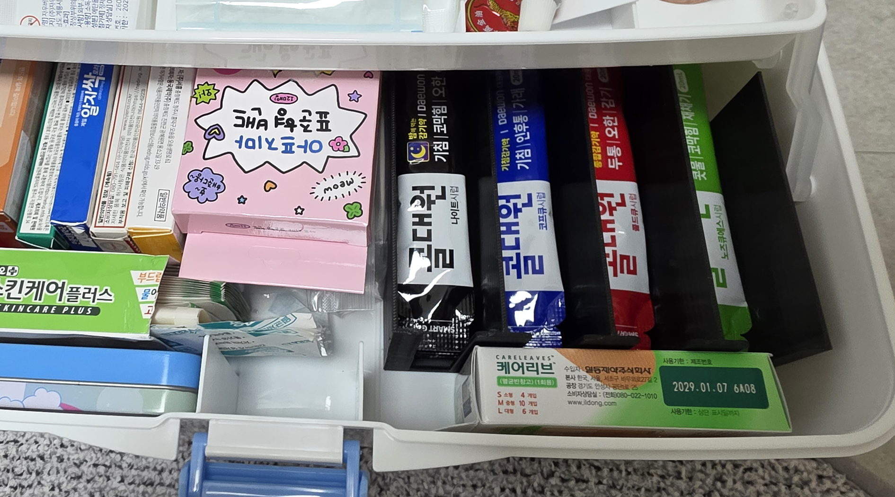

## 1. 제작 배경

### 기존 약상자의 문제점

약상자에 포 형태로 포장된 약을 보관하다 보니 정리와 관리에 불편함이 있었다.

포 형태의 약은 자체적으로 형태를 유지하기 어렵고, 여러 개를 함께 보관하면 서로 겹치거나 흐트러져 적재하기가 쉽지 않았다.

특히 다른 종류의 약과 함께 보관할 때 구분이 어렵고, 필요한 약을 꺼낼 때도 불편했다.

이를 해결하기 위해 약상자 내부에 설치할 수 있는 **4칸 적재용 디바이더**를 직접 제작하기로 했다.

### 제작 목표

- 약 포장 형태의 약을 4개 구역으로 구분하여 보관
- 약을 넣고 꺼내기 편리한 구조
- 기존 약상자 내부에 들어가는 맞춤형 크기
- 반복적인 사용에도 견딜 수 있는 충분한 내구성
- 약상자 문을 닫았을 때 간섭이 없도록 설계

## 2. 설계 및 모델링

### 전체 구조

약상자 내부에 설치할 수 있도록 바닥판과 구분용 벽을 일체형으로 구성했다.

총 4개의 보관 공간을 만들었으며, 약이 서로 섞이거나 흐트러지지 않도록 칸막이를 배치했다.

### 약상자에 맞춘 모서리 설계

기존 약상자의 내부 모서리가 직각이 아닌 라운딩 형태였기 때문에, 디바이더 역시 약상자에 밀착될 수 있도록 모서리 부분을 라운드 처리했다.

한쪽 꼭짓점에도 별도의 라운딩을 적용해 실제 약상자의 내부 형상과 간섭이 발생하지 않도록 고려했다.

### 약을 꺼내기 위한 공간 확보

칸막이 사이에 약을 넣고 꺼낼 때 손가락이 들어갈 수 있도록 공간을 확보했다.

손가락 두께를 고려해 입구의 크기를 조정하고, 손이 닿는 모서리는 라운딩 처리했다.

이를 통해 약을 꺼낼 때 불편함을 줄이고 날카로운 모서리에 손가락이 찔리는 문제도 예방하고자 했다.

### 벽 두께 및 내구성

초기에는 1mm 두께로 설계했으나, 실제 출력 과정에서 구조가 불안정한 문제가 있었다.

이를 개선하기 위해 두께를 약 1.8~2mm로 변경했다.

두께를 증가시켜 출력 안정성을 확보하고, 칸막이가 쉽게 휘거나 파손되지 않도록 했다.

## 3. 3D 프린팅

### 출력 설정

| 항목 | 설정 |
|---|---|
| 소재 | PETG |
| 노즐 온도 | 235°C |
| 베드 온도 | 75°C |
| 모델 두께 | 약 1.8~2mm |
| 출력 시간 | 약 10시간 |

### 출력 배치

슬라이서에서 모델의 배치와 출력 가능 여부를 확인한 후 출력을 진행했다.

  

약 10시간의 출력 과정을 거쳐 최종 부품을 완성했다.

## 4. 완성 및 실제 사용 결과

### 완성 결과

출력한 디바이더를 기존 약상자 내부에 설치했다.

설계 단계에서 고려했던 약상자 내부 모서리와의 간섭 없이 장착할 수 있었으며, 약을 4개 구역으로 나누어 보관할 수 있었다.

### 실제 사용성

실제 약을 적재해 본 결과, 처음 의도했던 대로 포 형태의 약을 안정적으로 보관할 수 있었다.

또한 약을 넣고 꺼내는 과정에서도 불편함이 없었으며, 칸막이의 강도와 전체적인 내구성도 만족스러웠다.

기존에 보관하던 다른 약들과 함께 정리할 수 있었고, 디바이더를 설치한 상태에서도 약상자의 문이 정상적으로 닫혔다.

### 결과 및 개선점

- **수납성:** 포 형태의 약을 4개 구역으로 구분하여 정리 가능
- **사용성:** 손가락 공간과 모서리 라운딩으로 약을 쉽게 꺼낼 수 있음
- **내구성:** 1.8~2mm 두께로 변경하여 안정적인 구조 확보
- **호환성:** 기존 약상자 내부에 맞게 제작하여 문을 닫는 데 문제가 없음

## 5. 제작 후기

이번 제작은 기존 제품의 구조를 그대로 사용하는 대신, 실제 생활에서 느낀 불편함을 해결하기 위해 필요한 부품을 직접 설계하고 제작한 사례다.

특히 모델링 단계에서 단순히 외형을 만드는 것뿐 아니라, 실제 사용자의 손가락 크기와 약상자의 내부 모서리 형태, 출력 안정성까지 고려해야 한다는 점을 경험했다.

또한 초기 설계에서 1mm로 설정했던 두께가 출력 과정에서 불안정해 1.8~2mm로 변경한 것처럼, 실제 출력 결과를 바탕으로 설계를 수정하는 과정도 중요했다.

앞으로도 생활 속에서 불편함을 느끼는 부분을 직접 모델링하고 출력하여 개선할 수 있는 물건들을 만들어 보고자 한다.